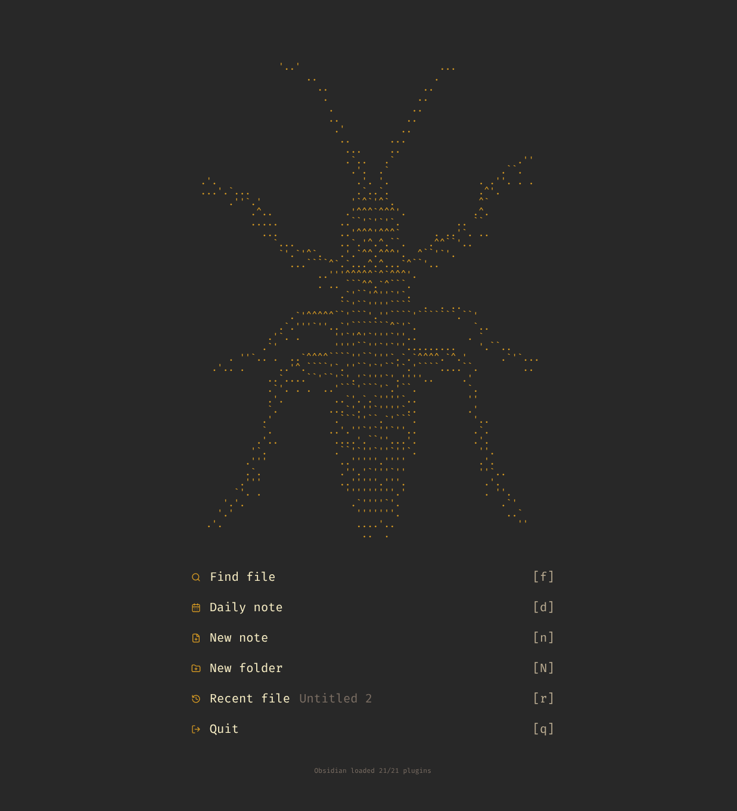

# motd

A Neovim-style start dashboard for Obsidian: your ASCII art, a list of
single-key actions, and a plugin-count footer. It lives in a pinned tab at
the front of the main tab group, so opening files moves you to new tabs and
the dashboard stays put.



| Key | Action |
|-----|--------|
| `f` | Find file (Omnisearch if enabled, otherwise Quick Switcher) |
| `d` | Today's daily note |
| `n` | New note |
| `N` | New folder |
| `r` | Most recent file |
| `q` | Quit (desktop only) |

Rows are clickable too, for mobile.

## Settings

- **ASCII art**: paste anything; it renders verbatim in a centered monospace
  block and shrinks (never wraps) to fit narrow panes.
- **Show on startup**: focus the dashboard when Obsidian opens.
- **Keep dashboard open**: reopen the pinned tab if it gets closed.

## Develop

```sh
npm install
npm run dev      # watch build
npm run deploy   # build + copy into $VAULT/.obsidian/plugins/motd (default ~/obs-notes)
```

Deploy copies files rather than symlinking so Obsidian Sync carries the plugin
to other devices.
